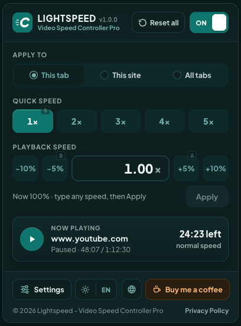

# Lightspeed - Video Speed Controller Pro

> A browser extension for Chromium and Firefox to control video playback speed on any website.



## Development

```bash
bun install           # install dependencies
bun run dev           # dev server with HMR (Chrome)
bun run dev:firefox   # dev server with HMR (Firefox)
bun run build         # build to .output/chrome-mv3
bun run build:firefox # build to .output/firefox-mv2
bun run zip           # build + package to .output/
bun run zip:firefox   # build + package Firefox to .output/
bun test              # run unit tests
```

## Privacy

See [PRIVACY.md](./PRIVACY.md).

## Author

Muhammad Fatkurozi · [hi@mardini.dev](mailto:hi@mardini.dev) · [Official Website](https://ibnumardini.github.io/lightspeed/)

## License

Apache-2.0
