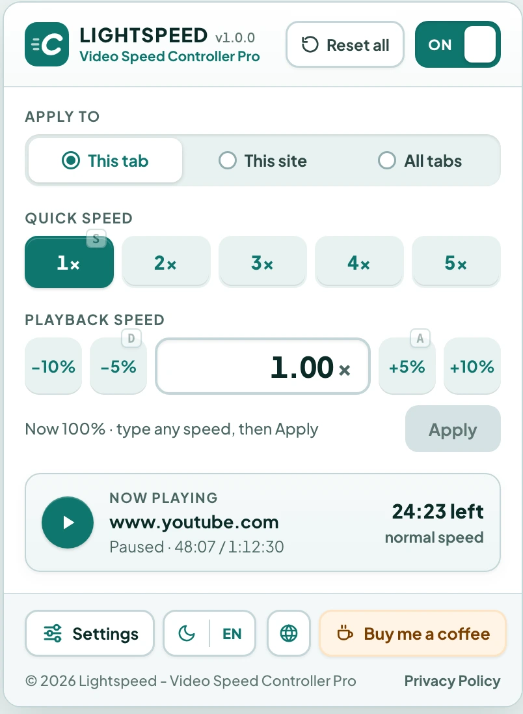
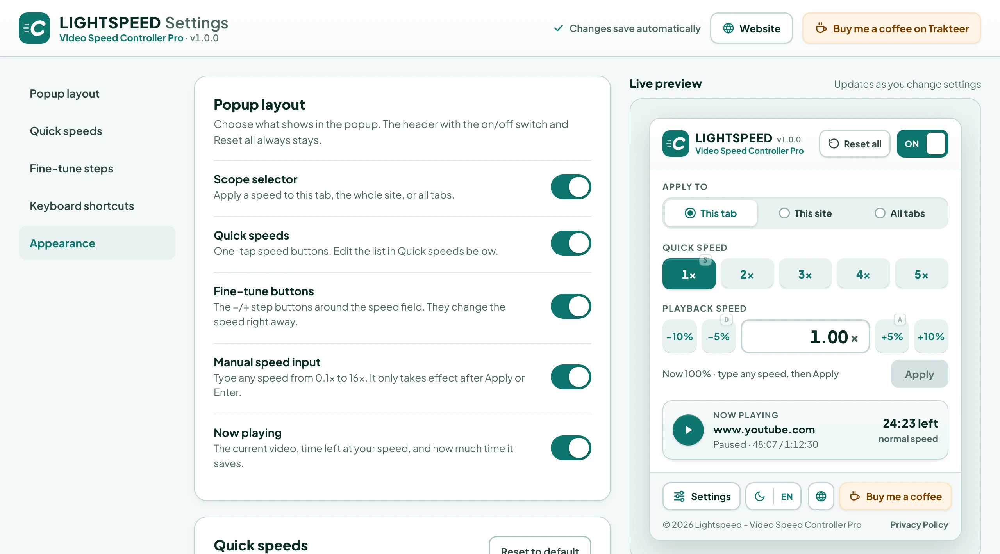

# Lightspeed - Video Speed Controller Pro

> 0.1× to 16× HTML5 video playback speed controller for Chromium (MV3) and Firefox-based (MV2) browsers. Per tab, per site, or across all tabs, with zero telemetry.

[Chrome Web Store](https://chromewebstore.google.com/detail/gndblfdplnlcbnckabpgbnjmbcmcpaac) · [Firefox Add-ons](https://addons.mozilla.org/en-US/firefox/addon/lightspeed-vid-speed-ctrl-pro/) · [Website](https://ibnumardini.github.io/lightspeed/) · [Releases](https://github.com/ibnumardini/lightspeed/releases) · [Privacy Policy](https://ibnumardini.github.io/lightspeed/privacy.html)



## Features

- **Flexible scope**: apply speed per tab, per site (saved locally), or across all tabs, including SPAs and iframes.
- **Quick speeds & fine-tune steps**: up to 10 customizable one-tap presets, preset or custom percentage nudge buttons, and direct `0.1×` to `16×` input.
- **Keyboard shortcuts**: `A` (speed up), `D` (slow down), and `S` (reset to `1×`), rebindable in Settings and disabled while typing.
- **Toolbar badge & Now playing**: live speed badge on the extension icon (hidden at `1×`, shows `OFF` when paused) plus remaining duration and time saved.
- **Settings with live preview**: toggle popup sections on/off, switch System/Light/Dark themes, pick from 6 WCAG-checked accents or a custom color, and switch between English and Bahasa Indonesia.



## Development

Built with [Bun](https://bun.sh), [WXT](https://wxt.dev), React, and TypeScript.

```bash
bun install           # install dependencies
bun run dev           # dev server with HMR (Chromium)
bun run dev:firefox   # dev server with HMR (Firefox)
bun run build         # build to .output/chrome-mv3
bun run build:firefox # build to .output/firefox-mv2
bun run zip           # build + package Chromium zip in dist/
bun run zip:firefox   # build + package Firefox zip in dist/
bun run compile       # TypeScript typecheck (tsc --noEmit)
bun test              # run unit tests
bun run docs          # preview the GitHub Pages landing site in docs/
```

### Load unpacked

- **Chrome / Edge / Brave**: open `chrome://extensions`, enable **Developer mode**, click **Load unpacked**, and select `.output/chrome-mv3`.
- **Firefox**: open `about:debugging#/runtime/this-firefox`, click **Load Temporary Add-on**, and select `.output/firefox-mv2/manifest.json`.

## Privacy

Zero telemetry, zero analytics, and zero external requests. All preferences stay inside browser storage. See [PRIVACY.md](./PRIVACY.md).

## Author

[Muhammad Fatkurozi](https://ibnu.mardini.dev) · [hi@mardini.dev](mailto:hi@mardini.dev) · [Official Website](https://ibnumardini.github.io/lightspeed/)

## License

Apache-2.0
